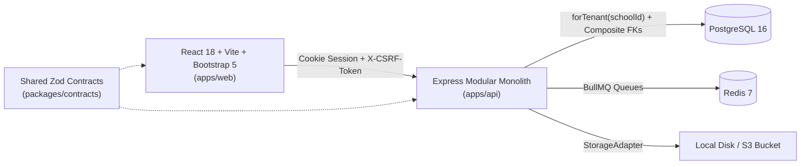

<div align="center">

# School Management System (School ERP)

**Multi-Tenant Cloud SaaS & Self-Hosted Standalone School ERP**

<p>
  <a href=".github/workflows/ci.yml">
    
  </a>
  <a href="tsconfig.base.json">
    
  </a>
  <a href="apps/web/package.json">
    
  </a>
  <a href="apps/api/prisma/schema.prisma">
    
  </a>
  <a href="LICENSE">
    
  </a>
</p>

<p>
  <a href="#-architecture">Architecture</a> •
  <a href="#-security--isolation">Security</a> •
  <a href="#-tech-stack">Tech Stack</a> •
  <a href="#-quick-start">Quick Start</a> •
  <a href="#-roadmap">Roadmap</a> •
  <a href="School%20Management%20System.md">PRD</a>
</p>

</div>

---

> [!NOTE]
> **Project Status — Phase 0 Complete (Foundation & Security Core)**
> Core monorepo, multi-tenant schema, Argon2id session + CSRF auth, Local/S3 storage adapters, OpenAPI 3.1 docs, CI pipeline, and Bootstrap 5 web shell are implemented and verified. Full product specification: [School Management System.md](School%20Management%20System.md).

---

## ✨ Why This Architecture

| Capability | Design |
|---|---|
| **Dual Deployment (`APP_MODE`)** | One codebase runs as **Cloud SaaS** (`saas`, multi-school) or **Standalone** (`standalone`, single-school self-hosted). |
| **Defense-in-Depth Isolation** | Composite foreign keys `(school_id, entity_id)` + mandatory `forTenant(schoolId)` Prisma client extension (with PostgreSQL RLS hardening in Phase 6). |
| **Hardened Auth & Sessions** | `Argon2id` hashing, HTTP-only `SameSite=Lax` PostgreSQL sessions, per-session `X-CSRF-Token`, `Origin` checks, and `active_school_id` switching. |
| **Interchangeable Storage** | Unified `StorageAdapter` for local disk or S3-compatible object storage with magic-byte MIME validation (SVG/HTML blocked). |
| **Contract-First API** | Shared `@school-erp/contracts` Zod schemas driving both request validation and **OpenAPI 3.1** docs (`/docs`, `/openapi.json`). |

---

## 🏗 Architecture



---

## 🛡 Security & Isolation

- **Multi-School Safe Roles:** `user_roles` is bound to `(school_membership_id, school_id, role_id)`—preventing privilege bleed across schools.
- **No Trust in Client Uploads:** Magic-byte inspection allows only `PNG`, `JPEG`, `WebP`, and `PDF`; private downloads enforce `Content-Disposition: attachment` or short-lived S3 signed URLs.
- **Atomic School Sequences:** `document_sequences` generates race-free, school-scoped prefixes (`ADM-`, `EMP-`, `INV-`, `RCP-`, `JRN-`).
- **Fail-Fast Config:** Startup Zod validation rejects unsafe production defaults (`SESSION_SECRET`, missing S3 credentials).

---

## 🧰 Tech Stack

| Layer | Technologies |
|---|---|
| **Frontend** | React 18 • Vite 6 • TypeScript • Bootstrap 5 • React Router • TanStack Query • React Hook Form • Zod |
| **Backend** | Node.js 22+ • Express • TypeScript • Prisma ORM • Zod • Argon2id • Pino • BullMQ |
| **Data & Queue** | PostgreSQL 16 • Redis 7 |
| **Storage & Docs** | Local / AWS S3 SDK (`@aws-sdk/client-s3`) • OpenAPI 3.1 (`zod-to-openapi` + Swagger UI) |
| **Testing & CI** | Vitest • Supertest • GitHub Actions |

---

## 📂 Workspace Layout

<details>
<summary>Explore monorepo structure</summary>

```text
school-erp/
├── apps/
│   ├── api/
│   │   ├── prisma/
│   │   │   ├── migrations/0001_phase0_partial_indexes/
│   │   │   ├── schema.prisma
│   │   │   └── seed.ts
│   │   └── src/
│   │       ├── config/         # Fail-fast Zod environment loader
│   │       ├── lib/            # Prisma forTenant, storage adapters, OpenAPI, errors, logger, audit
│   │       ├── middleware/     # Auth, CSRF, tenant scope, RBAC permissions, request context
│   │       └── modules/        # Modular monolith feature slices (auth, files, ...)
│   └── web/
│       └── src/
│           ├── api/            # Typed fetch client with CSRF injection
│           ├── components/     # Responsive Bootstrap 5 shell & UI states
│           ├── context/        # Auth + active school switcher
│           └── features/       # Login & role-aware dashboard
├── packages/
│   └── contracts/              # Shared Zod DTOs & permission constants
├── docker/
│   └── docker-compose.yml      # PostgreSQL 16 + Redis 7
└── .github/workflows/ci.yml
```

</details>

---

## 🚀 Quick Start

### 1. Prerequisites
- **Node.js** `>= 22` and **pnpm** `9+`
- **Docker** & **Docker Compose**

### 2. Run Locally

```bash
# Install dependencies
pnpm install

# Configure environment variables
cp .env.example .env

# Start PostgreSQL 16 & Redis 7
docker compose -f docker/docker-compose.yml up -d

# Generate Prisma client, apply migrations, and bootstrap standalone admin/school
pnpm db:generate
pnpm db:migrate
pnpm db:bootstrap

# Start API (http://localhost:4000) and Web (http://localhost:5173)
pnpm dev
```

### 3. Verify & Inspect

| Command / URL | Purpose |
|---|---|
| `pnpm typecheck` | Typecheck `contracts`, `api`, and `web` |
| `pnpm build` | Build shared contracts, API, and production Vite bundle |
| `pnpm test` | Run Vitest security & client test suites |
| `http://localhost:4000/docs` | Interactive OpenAPI 3.1 Swagger UI |
| `http://localhost:4000/healthz` | API liveness & active `APP_MODE` |

---

## 🗺 Roadmap

| Phase | Scope | Status |
|---|---|---|
| **Phase 0** | Monorepo, Docker, Prisma core, Argon2id + CSRF, `forTenant`, Storage, OpenAPI 3.1, Web Shell, CI | ✅ Done |
| **Phase 1** | Schools, RBAC UI, academic years, staff/teachers, students & guardians | 🔜 Next |
| **Phase 2** | Daily/period attendance, leave, conflict-free timetable, exams, homework, promotions | 📋 Planned |
| **Phase 3A & 5A (MVP)** | Fee structures, invoices, payments, `pdfkit` receipts, refunds, parent/student read-only portals | 📋 Planned |
| **Phase 3B & 4** | Double-entry accounting, library, transport, hostel, async notifications | 📋 Planned |
| **Phase 5B – 7** | Online exams, dynamic school website, SaaS billing, PostgreSQL RLS, QA & production release | 📋 Planned |

---

## 📄 License

Distributed under the **MIT License**. See [LICENSE](LICENSE) for full terms.

---

<div align="center">

**Build by Abdurrahman**

</div>
