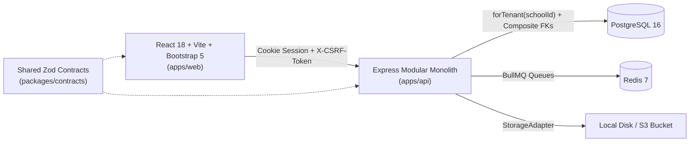

<div align="center">

# EduNexa — School Management System (School ERP)

**Multi-Tenant Cloud SaaS & Self-Hosted Standalone School ERP + Public School Website**

<p>
  <a href=".github/workflows/ci.yml">
    
  </a>
  <a href="tsconfig.base.json">
    
  </a>
  <a href="apps/web/package.json">
    
  </a>
  <a href="apps/api/prisma/schema.prisma">
    
  </a>
  <a href="LICENSE">
    
  </a>
</p>

<p>
  <a href="#-architecture">Architecture</a> •
  <a href="#-security--isolation">Security</a> •
  <a href="#-tech-stack">Tech Stack</a> •
  <a href="#-quick-start">Quick Start</a> •
  <a href="#-roadmap">Roadmap</a> •
  <a href="School%20Management%20System%20v1.1.md">PRD v1.1</a>
</p>

</div>

---

> [!NOTE]
> **Project Status — Phases 0–7 + EduNexa Public Portal & CMS Implemented & Verified**
> Full modular-monolith ERP covering Core Admin, Academics, Attendance, Timetable, Exams/Online Exams, Homework, Fees (`pdfkit` + `exceljs`), Double-Entry Accounting, Library, Transport, Hostel, BullMQ Notifications, SSR School Website (`Home`, `Classes`, `Our Teachers`, `News & Notices`, `Events`, `Admissions`, `Gallery`, `Contact Us` + admin CMS), Auth & Password Reset UI, SaaS Platform Onboarding, Offline Licensing, and PostgreSQL `FORCE ROW LEVEL SECURITY`. Full specification: [School Management System v1.1.md](School%20Management%20System%20v1.1.md).

---

## ✨ Why This Architecture

| Capability | Design |
|---|---|
| **Dual Deployment (`APP_MODE`)** | One codebase runs as **Cloud SaaS** (`saas`, multi-school) or **Standalone** (`standalone`, single-school self-hosted). |
| **Defense-in-Depth Isolation** | Composite foreign keys `(school_id, entity_id)` + mandatory `forTenant(schoolId)` Prisma client extension (with PostgreSQL RLS hardening in Phase 6). |
| **Hardened Auth & Sessions** | `Argon2id` hashing, HTTP-only `SameSite=Lax` PostgreSQL sessions, per-session `X-CSRF-Token`, `Origin` checks, and `active_school_id` switching. |
| **Interchangeable Storage** | Unified `StorageAdapter` for local disk or S3-compatible object storage with magic-byte MIME validation (SVG/HTML blocked). |
| **Contract-First API** | Shared `@school-erp/contracts` Zod schemas driving both request validation and **OpenAPI 3.1** docs (`/docs`, `/openapi.json`). |

---

## 🏗 Architecture



---

## 🛡 Security & Isolation

- **Multi-School Safe Roles:** `user_roles` is bound to `(school_membership_id, school_id, role_id)`—preventing privilege bleed across schools.
- **No Trust in Client Uploads:** Magic-byte inspection allows only `PNG`, `JPEG`, `WebP`, and `PDF`; private downloads enforce `Content-Disposition: attachment` or short-lived S3 signed URLs.
- **Atomic School Sequences:** `document_sequences` generates race-free, school-scoped prefixes (`ADM-`, `EMP-`, `INV-`, `RCP-`, `JRN-`).
- **Fail-Fast Config:** Startup Zod validation rejects unsafe production defaults (`SESSION_SECRET`, missing S3 credentials, or `ENABLE_DEMO_QUICK_SIGNIN=true` in production).
- **Hardened Public SSR & Forms:** Self-hosted static assets (`/public/assets/*`) satisfy strict Helmet CSP, `sanitizeRichHtml` strips unsafe tags/handlers/URIs, and public Admissions/Contact POSTs enforce rate limiting, same-origin checks, and allowlisted error codes.
- **PostgreSQL Row-Level Security (RLS):** Migrations `0004`–`0006` enforce `FORCE ROW LEVEL SECURITY` scoped by `app.current_school_id`.

---

## 🌐 EduNexa Public Website & Auth Experience

- **Smart Root Routing (`/`):** Unauthenticated visitors opening `http://localhost:5173/` are routed to the active school's SSR landing page (`/public` → `/public/demo-school`); authenticated users open the grouped dark-sidebar EduNexa Dashboard.
- **Public Pages:** `Home`, `About`, `Academics`, `Classes` (student counts, sections, subjects), `Our Teachers` (designation, specialization, qualifications, experience—zero contact PII), `Admissions` (online application form stored in `admission_applications`), `Events`, `News & Notices`, `Gallery`, and `Contact Us` (inquiries stored in `contact_inquiries`).
- **Website Manager (`/website`):** Admin CMS to update Hero/Contact settings, publish pages/news/events, and review/update Admission Applications and Contact Inquiries.
- **Authentication:** `/login` (password toggle, `Remember me` 30-day session, MFA TOTP prompt), `/forgot-password`, `/reset-password`, and dev-only 9-role **Quick Sign In** (`Superadmin`, `Admin`, `Teacher`, `Parent`, `Student`, `Accountant`, `Librarian`, `Driver`, `Hostel` — requires `NODE_ENV !== 'production'` and `ENABLE_DEMO_QUICK_SIGNIN=true`).

---

## 🧰 Tech Stack

| Layer | Technologies |
|---|---|
| **Frontend** | React 18 • Vite 6 • TypeScript • Bootstrap 5 • React Router • TanStack Query • React Hook Form • Zod |
| **Backend** | Node.js 22+ • Express • TypeScript • Prisma ORM • Zod • Argon2id • Pino • BullMQ |
| **Data & Queue** | PostgreSQL 16 • Redis 7 |
| **Storage & Docs** | Local / AWS S3 SDK (`@aws-sdk/client-s3`) • OpenAPI 3.1 (`zod-to-openapi` + Swagger UI) |
| **Testing & CI** | Vitest • Supertest • GitHub Actions |

---

## 📂 Workspace Layout

<details>
<summary>Explore monorepo structure</summary>

```text
school-erp/
├── apps/
│   ├── api/
│   │   ├── prisma/
│   │   │   ├── migrations/
│   │   │   │   ├── 0001_phase0_partial_indexes/
│   │   │   │   ├── 0002_phase1_partial_indexes/
│   │   │   │   ├── 0003_phase4_partial_indexes/
│   │   │   │   ├── 0004_phase6_rls/
│   │   │   │   ├── 0005_phase7_admission_applications/
│   │   │   │   └── 0006_phase7_contact_inquiries/
│   │   │   ├── schema.prisma
│   │   │   └── seed.ts         # Standalone bootstrap + dev demo accounts & showcase seed
│   │   ├── public/assets/      # Self-hosted theme CSS, Bootstrap Icons & EduNexa SVGs
│   │   └── src/
│   │       ├── config/         # Fail-fast Zod environment loader
│   │       ├── lib/            # Prisma forTenant + nextDocumentNumber, storage, OpenAPI, errors
│   │       ├── middleware/     # Auth, CSRF, tenant scope, RBAC permissions, module guards
│   │       └── modules/        # Modular monolith feature slices (auth, academic, website, ...)
│   └── web/
│       ├── public/assets/      # EduNexa SVG logo & favicon
│       └── src/
│           ├── api/            # Typed fetch client with CSRF injection
│           ├── components/     # Grouped EduNexa sidebar shell (AppLayout) & UI states
│           ├── context/        # Auth, quick-signin, logout & active school switcher
│           ├── features/       # Auth, Dashboard, Academic, Operations, Finance, Website CMS, Settings
│           └── styles/         # Shared EduNexa stylesheet (theme.css)
├── packages/
│   └── contracts/              # Shared Zod DTOs & permission constants (TS Project References)
├── docker/
│   └── docker-compose.yml      # Optional PostgreSQL 16 + Redis 7 containers
└── .github/workflows/ci.yml
```

</details>

---

## 🚀 Quick Start

### 1. Prerequisites
- **Node.js** `>= 22` and **pnpm** `9+`
- **PostgreSQL 16+** & **Redis 7+** (either installed natively via `apt`/OS package or via **Docker Compose**)

### 2. Run Locally

```bash
# Install dependencies
pnpm install

# Configure environment variables (set ENABLE_DEMO_QUICK_SIGNIN=true for dev demo accounts/quick-signin)
cp .env.example .env

# Option A: Native PostgreSQL + Redis (ensure role/db `school_erp` matches .env; grant `school_erp_app` to `school_erp` for RLS tests)
# Option B: Docker Compose
docker compose -f docker/docker-compose.yml up -d

# Push Prisma schema, apply partial-index & RLS SQL migrations, and bootstrap seed data
pnpm db:push
for f in apps/api/prisma/migrations/000*/migration.sql; do
  sudo -u postgres psql -d school_erp -v ON_ERROR_STOP=1 -f "$f"
done
sudo -u postgres psql -d school_erp -c "GRANT school_erp_app TO school_erp;" 2>/dev/null || true
pnpm db:bootstrap

# Start API (http://localhost:4000) and Web (http://localhost:5173)
pnpm dev
```

### 3. Verify & Inspect

| Command / URL | Purpose |
|---|---|
| `pnpm typecheck` | Typecheck `contracts`, `api`, and `web` |
| `pnpm build` | Build shared contracts, API, and production Vite bundle |
| `pnpm test` | Run Vitest suites (API: 46 tests / 10 files incl. live RLS; Web: 1 test; contracts ok) |
| `http://localhost:5173/` | Public EduNexa school website when signed out; Dashboard when signed in |
| `http://localhost:5173/public/demo-school` | Public school landing page & subpages (`/classes`, `/teachers`, `/admissions`, `/contact`, etc.) |
| `http://localhost:5173/login` | Sign In, Forgot/Reset Password & dev-only 9-role Quick Sign In |
| `http://localhost:4000/docs` | Interactive OpenAPI 3.1 Swagger UI |
| `http://localhost:4000/healthz` | API liveness & active `APP_MODE` |

---

## 🗺 Roadmap

| Phase | Scope | Status |
|---|---|---|
| **Phase 0** | Monorepo, Docker, Prisma core, Argon2id + CSRF, `forTenant`, Storage, OpenAPI 3.1, Web Shell, CI | ✅ Done |
| **Phase 1** | Schools, RBAC UI, academic years, staff/teachers, students & guardians, CSV dry-run import | ✅ Done |
| **Phase 2** | Daily/period attendance, leave, conflict-free timetable, exams, homework, promotions/TCs | ✅ Done |
| **Phase 3A & 5A (MVP)** | Fee structures, invoices, payments, `pdfkit` receipts/report cards, `exceljs` export, maker-checker refunds, portals | ✅ Done |
| **Phase 3B & 4** | Double-entry accounting, library, transport, hostel, BullMQ async notifications | ✅ Done |
| **Phase 5B – 7** | Online exams, SSR dynamic school website, SaaS onboarding, PostgreSQL RLS, offline licence, full export | ✅ Done |

---

## 📄 License

Distributed under the **MIT License**. See [LICENSE](LICENSE) for full terms.

---

<div align="center">

**Build by Abdurrahman**

</div>
